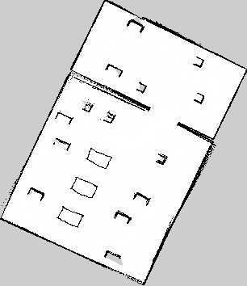
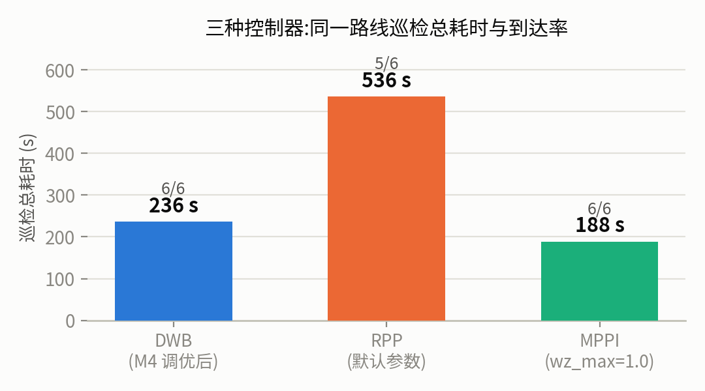

# WarehouseRunner

**A complete ROS 2 warehouse navigation stack: SLAM mapping, tuned Nav2, a three-controller benchmark, and behavior-tree precision docking — on the TIAGo robot in Gazebo Classic.**


<p align="center">
  
  
</p>
<p align="center"><i>Left: SLAM occupancy grid of the warehouse (306&times;354 cells @ 5 cm, built with slam_toolbox).
Right: patrol benchmark across three local controllers.</i></p>

## Highlights

- **Full pipeline** — SLAM mapping &rarr; localization (AMCL) &rarr; navigation (Nav2) &rarr; waypoint patrol &rarr; parameter tuning &rarr; controller benchmark &rarr; BT-based precision docking, all in one reusable package (`wr_bringup`).
- **71% faster patrol from parameter tuning alone** (829 s &rarr; 236 s, 5/6 &rarr; 6/6 waypoints) with a controlled one-knob-at-a-time protocol and full run logs as evidence.
- **Head-to-head controller benchmark** (DWB vs Regulated Pure Pursuit vs MPPI) on an identical 6-waypoint loop, including failure analysis: RPP's structural goal-convergence deficit and MPPI's localization-coupling failure at high angular velocity.
- **Behavior-tree precision docking**: custom BT nodes (plugin-based, Groot-monitorable) with a distance-triggered slow-approach speed zone, a tight goal checker, dead-reckoned backup correction, and live-TF dock verification.
- **Engineering write-ups** — every non-obvious failure and its root cause is documented (see *Lessons learned* and the report).

## Results

**Parameter tuning** (6-waypoint patrol benchmark; all logs in [`wr_bringup/results/`](wr_bringup/results/)):

| Configuration | Change | Waypoints | Time |
|---|---|---|---|
| Baseline | $v_{max}$=0.3 m/s, $T_{sim}$=1.7 s, inflation 0.55 m | 5/6 | 829 s |
| Speed | $v_{max}$=0.5 m/s, $\omega_{max}$=1.0 rad/s | 6/6 | 258 s |
| Horizon | $T_{sim}$=1.0 s | 6/6 | **236 s** |
| Inflation 0.35 / 0.80 m | tested, not adopted | 6/6 | 259 / 292 s |

**Controller comparison** (same benchmark, MPPI configured with $\omega_{max}$=1.0 rad/s):

| Controller | Waypoints | Time | Notes |
|---|---|---|---|
| DWB (tuned) | 6/6 | 236 s | robust workhorse |
| RPP | 5/6 | 536 s | stalls 0.26–0.36 m outside goal tolerance |
| **MPPI** | **6/6** | **188 s** | best; stock $\omega_{max}$=1.9 rad/s destabilizes AMCL (0/6) |

## Repository structure

```
WarehouseRunner/
├── wr_bringup/                 # the ROS 2 (ament_cmake) package
│   ├── launch/                 #   warehouse simulation launch
│   ├── maps/                   #   SLAM map (pgm + yaml), table tops painted lethal
│   ├── config/                 #   tuned Nav2 params (3 controllers, 2 goal checkers)
│   │   └── bt/                 #   Nav2-side behavior-tree variants (controller/checker selection)
│   ├── behavior_tree_xml/      #   application-side docking behavior tree
│   ├── scripts/                #   waypoint patrol, one-shot bring-up, robust arm tuck
│   ├── src/ + include/         #   custom BT nodes (C++, plugin-based)
│   └── results/                #   raw run logs backing every number above
├── report/                     # LaTeX report + chart generator (matplotlib)
└── media/                      # screenshots & recordings (to be added)
```

## Getting started

### Prerequisites

- Ubuntu 22.04, [ROS 2 Humble](https://docs.ros.org/en/humble/Installation.html), Gazebo Classic 11
- `ros-humble-navigation2`, `ros-humble-nav2-bringup`, `ros-humble-slam-toolbox`, `ros-humble-topic-tools`, `ros-humble-behavior-tree-cpp-v3`
- The [book_ros2](https://github.com/fmrico/book_ros2) workspace (provides `br2_tiago`, `br2_navigation`) and PAL's `pal_gazebo_worlds` (provides `small_office_inventory.world`) — clone both into your workspace `src/` alongside this package.

```bash
mkdir -p ~/warehouse_runner_ws/src && cd ~/warehouse_runner_ws/src
git clone https://github.com/fmrico/book_ros2
git clone https://github.com/pal-robotics/pal_gazebo_worlds
git clone <this-repo>
cd .. && rosdep install --from-paths src -y --ignore-src
colcon build --symlink-install && source install/setup.bash
```

### Usage

```bash
# 1. Simulation (TIAGo in the warehouse; arm tucks automatically)
ros2 launch wr_bringup warehouse_sim.launch.py

# 2. Navigation stack (pre-built map + tuned parameters)
ros2 launch br2_navigation tiago_navigation.launch.py \
  map:=$(ros2 pkg prefix wr_bringup)/share/wr_bringup/maps/warehouse.yaml \
  params_file:=$(ros2 pkg prefix wr_bringup)/share/wr_bringup/config/tiago_nav_params.yaml
# then set the initial pose in RViz (2D Pose Estimate), or:

# 3. One-shot: simulation + odom gate + Nav2 + AMCL seed + docking demo
ros2 run wr_bringup bringup_m6.sh          # or: ... --no-demo for the stack only

# 4. Waypoint patrol benchmark
ros2 run wr_bringup waypoint_patrol.py

# 5. Watch the docking behavior tree live (optional)
~/path/to/Groot    # Monitor mode -> localhost:2666
```

Controller switching (DWB / RPP / MPPI) is a one-line change in `config/tiago_nav_params.yaml` (`default_nav_to_pose_bt_xml`) — each Nav2-side BT variant binds a controller and a goal checker.

### Reproduce the report

```bash
cd report
python3 make_charts.py            # regenerates all figures from the raw logs
latexmk -xelatex main.tex         # builds report/main.pdf (XeLaTeX + ctex)
```

## Milestones

| # | Milestone | Status |
|---|---|---|
| M1 | Warehouse simulation bring-up | ✅ |
| M2 | SLAM mapping (+ overhanging-table handling from world ground truth) | ✅ |
| M3 | Nav2 multi-goal patrol | ✅ |
| M4 | Parameter tuning with evidence | ✅ |
| M5 | DWB / RPP / MPPI benchmark | ✅ |
| M6 | Behavior-tree precision docking | code complete, final demo recording pending |
| M7 | Custom controller plugin (Stanley / PID-PP) | planned |

## Lessons learned

Condensed from the debugging notes in the report; each cost real hours:

1. **DWB has two independent speed caps** — `max_vel_x` and `max_speed_xy`. Raising only one silently clamps.
2. **A controller can destabilize localization.** MPPI at $\omega_{max}$=1.9 rad/s spun TIAGo fast enough to break AMCL's scan matching (front-only lidar) — the same controller at 1.0 rad/s scores 6/6. Controller quality and state-estimation quality are coupled.
3. **`/amcl_pose` is event-driven** (republished after ~25 cm of motion). Anything that verifies pose at standstill must read live TF, or it sees a stale pose.
4. **With multiple goal checkers registered**, every goal must come from a behavior tree that names its checker — an empty `goal_checker_id` aborts `FollowPath`.
5. **ROS launch files don't install themselves** — `install(DIRECTORY launch config ...)` in CMakeLists, always.
6. `ros2 launch ... arg:=~/path` does **not** expand `~` — use absolute paths or `$HOME`.

## Citation

If you build on this work, the accompanying course report (in `report/`, Chinese) documents all experiments:

```bibtex
@misc{warehouserunner2026,
  title  = {WarehouseRunner: SLAM, tuned Nav2, controller benchmarking and
            behavior-tree precision docking with ROS 2},
  author = {qx},
  year   = {2026},
  url    = {https://github.com/<your-user>/WarehouseRunner}
}
```

## License & acknowledgments

Apache-2.0. The TIAGo simulation and warehouse world come from [book_ros2](https://github.com/fmrico/book_ros2) (Intelligent Robotics Lab, URJC) and [PAL Robotics](https://github.com/pal-robotics); navigation is [Nav2](https://github.com/ros-planning/navigation2). `wr_bringup/include/.../ctrl_support/BTActionNode.hpp` is adapted from `book_ros2`'s `br2_bt_patrolling` (Apache-2.0).
